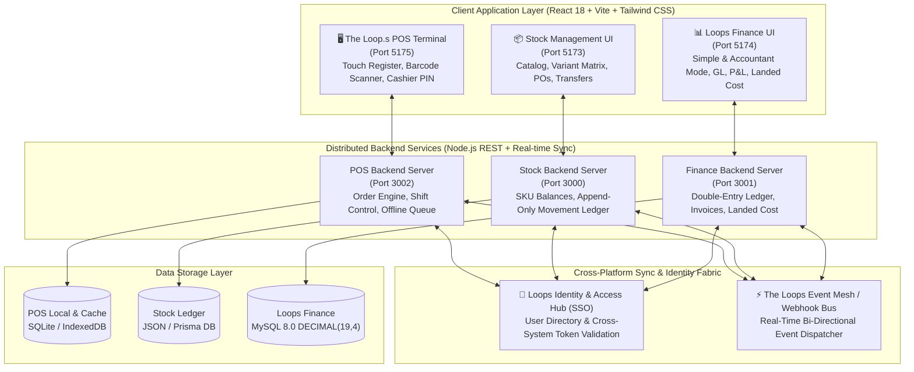
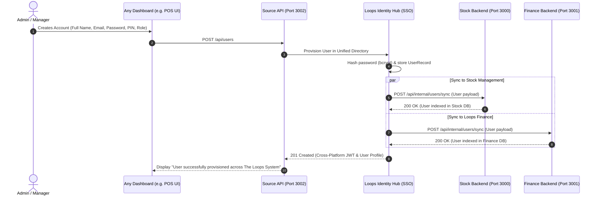
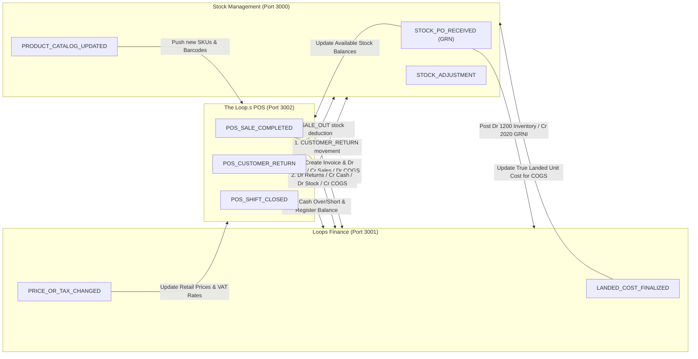

# 🌐 The Loops System — Triad POS Master Architecture & Implementation Plan
## Universal Point of Sale (POS) Integrated with Stock Management Loops & Account System Loops

> **Platform Ecosystem:** The Loops Universal Retail Suite  
> **Comprising Systems:**  
> 1. 🏬 **The Loop.s POS Terminal** (`The_Loop.s_POS` — Port 3002 API / Port 5175 UI)  
> 2. 📦 **Stock Management Loops** (`Stock_management_loops` — Port 3000 API / Port 5173 UI)  
> 3. 📊 **Account System Loops (Loops Finance V3)** (`account_system_Loops` — Port 3001 API / Port 5174 UI)  
> **Core Directives:**  
> - **Unified Identity & Access**: Create a user account on *any* dashboard (POS, Stock, or Finance) $\rightarrow$ automatically provisioned and granted access across all three platforms with role-based permissions.  
> - **Real-Time Triad Data Sync**: Every transaction, inventory movement, price adjustment, and shift reconciliation instantly updates across all platforms without manual intervention.

---

## 1. System Ecosystem Architecture



---

## 2. Universal Identity & Cross-Platform User Provisioning

### 2.1 The Single Source of Identity Problem & Solution
When an administrator or manager registers an employee inside **The Loop.s POS dashboard**, that user must be able to log in to **Stock Management Loops** and **Account System Loops** with zero friction and without re-registering.



### 2.2 Unified User Model & Role-Based Access Control (RBAC)

| Role | POS Permissions | Stock Management Permissions | Loops Finance Permissions | Typical Users |
| :--- | :--- | :--- | :--- | :--- |
| **SUPER_ADMIN** | Full administrative control, voids, overrides | Full catalog, POs, write-offs, transfers | Full General Ledger, Tax, Capital, Auditing | Owner, CEO |
| **STORE_MANAGER** | Register open/close, discounts, refunds, Z-Reports | Manage on-hand stock, accept POs, transfers | View daily sales, register reconciliations | Store & Branch Managers |
| **CASHIER** | Scan, ring up sales, accept payments, quick PIN switch | View-only stock lookup (availability by store) | *No direct access* (sales automatically post) | Frontline Retail Staff |
| **INVENTORY_CLERK** | View catalog and inventory search only | Stock receiving (GRN), cycle counts, movement logging | View PO clearing & Landed Cost goods receipts | Stockroom & Warehouse staff |
| **ACCOUNTANT** | View completed sales & shift summary reports | View stock valuation & movement reports | Full Double-Entry GL, P&L, Balance Sheet, Landed Cost | Financial Controller, CPA |

### 2.3 Dual Credential Authentication (Web Password + POS Quick PIN)
- **Web & Dashboard Access**: Email + Password (Bcrypt hash) for backoffice browsers across ports 5173, 5174, and 5175.
- **Fast Cashier Switching on POS**: 4-digit or 6-digit numeric Cashier PIN for instant unlock during busy retail checkout shifts without typing emails.
- **Unified JWT Token**: Includes `userId`, `email`, `role`, `accessibleSystems: ['POS', 'STOCK', 'FINANCE']`, and cryptographically signed with a shared `LOOPS_JWT_SECRET`.

---

## 3. The Loop.s POS Architecture & Features

The POS is engineered as a dedicated high-throughput retail terminal (`The_Loop.s_POS`) conforming strictly to the obsidian & porcelain luxury aesthetic described in `design_system_skill.md` and `Pro_max_skill_Ui.md`.

### 3.1 Project File Layout

```
The_Loop.s_POS/
├── backend/                         # Node.js POS Microservice (Port 3002)
│   ├── src/
│   │   ├── server.js                # REST API & Webhook Dispatcher
│   │   ├── auth.js                  # Shared JWT & Cashier PIN Verification
│   │   ├── orderEngine.js           # Multi-tier Cart, Discounts, Tax Calculation
│   │   ├── shiftManager.js          # Cash float, Mid-shift X-Report, Day-end Z-Report
│   │   ├── syncEngine.js            # Dual-bridge to Stock (Port 3000) & Finance (Port 3001)
│   │   ├── receiptPrinter.js        # ESC/POS Thermal 80mm & PDF Engine
│   │   └── db.js                    # Local POS Transaction Store
│   └── package.json
└── frontend/                        # React 18 + Vite + Tailwind CSS (Port 5175)
    ├── src/
    │   ├── components/
    │   │   ├── TerminalHeader.jsx   # Cashier status, Online/Offline pill, Store Location
    │   │   ├── ProductCatalogGrid.jsx# Search, Category pills, Variant Matrix Modal
    │   │   ├── BarcodeListener.jsx  # Hardware USB HID scanner buffer listener
    │   │   ├── ActiveCart.jsx       # Order line items, qty modifiers, line discounts
    │   │   ├── CheckoutModal.jsx    # Cash, Credit Card, QR Pay, Customer Store Credit
    │   │   ├── ShiftModal.jsx       # Open register with Float, Close with Blind Count
    │   │   ├── ReceiptPreview.jsx   # Interactive printable receipt modal
    │   │   └── UserManagement.jsx   # Cross-platform account creation modal
    │   ├── context/
    │   │   ├── PosContext.jsx       # State: Cart, Active Cashier, Active Register
    │   │   └── SyncContext.jsx      # Network & synchronization heartbeat
    │   ├── App.jsx
    │   └── main.jsx
    ├── package.json
    └── tailwind.config.js
```

### 3.2 High-Speed POS Terminal Features
1. **Touch Variant Matrix Picker**:
   - Single-tap selection for configurable attributes: **Color × Size × Finish × Capacity**.
   - Live availability badge directly on variant tiles (e.g. `Matte Black / Large (8 in stock)` vs `Titanium / Small (OOS)`).
2. **Universal Barcode Scanning**:
   - Automatic keyboard-wedge (USB HID) listener catches barcode scanners instantaneously without requiring manual focus on an input box.
   - Fallback on-screen camera scanner for tablet devices.
3. **Multi-Payment & Split Tender**:
   - Split single order into multiple tenders: e.g. `$50.00 Cash + $75.00 Credit Card + $10.00 Store Credit`.
   - Real-time change calculation with prominent cash denomination quick buttons (`$10`, `$20`, `$50`, `$100`).
4. **Shift & Cash Register Lifecycle**:
   - **Opening Float**: Cashier counts and logs opening currency in drawer.
   - **Mid-Shift X-Report**: Non-resetting interim reading of sales, cash in drawer, card totals.
   - **Closing Z-Report**: Final blind cash count; calculates cash over/short discrepancy; sends reconciliation journal directly to Accounts.
5. **Offline-First Resilience**:
   - If local internet or either peer server is temporarily unreachable, sales are committed locally into IndexedDB with UUID idempotency keys.
   - As soon as connectivity restores, the POS sync worker drains the queue in strict chronological order.

---

## 4. End-to-End Real-Time Triad Synchronization Engine

### 4.1 Master Event Catalog



### 4.2 Exact Data Flow Scenarios

#### Scenario A: Retail Sale at POS Terminal
1. Cashier scans barcode `SKU-TSHIRT-BLK-M` and collects \$45.00 cash.
2. POS generates unique `saleId: "SALE-POS-20261101-0042"`.
3. **Immediate Stock Movement (Port 3000)**:
   - POS dispatches `POST /api/movements` to Stock Management backend.
   - Movement recorded: `type: "SALE_OUT"`, `sku: "SKU-TSHIRT-BLK-M"`, `quantity: -1`, `locationId: "loc-1"`.
   - On-hand stock decrements immediately from 12 to 11.
4. **Immediate Accounting Journal Entry (Port 3001)**:
   - POS dispatches `POST /api/invoices` and `POST /api/journal-entries` to Loops Finance backend.
   - Double-entry transaction created:
     * `Dr 1010 Cash on Hand`: \$45.00
     * `Cr 4010 Retail Sales Revenue`: \$45.00
     * `Dr 5010 Landed Cost of Goods Sold`: \$18.50 *(automatically calculated from Finance Landed Cost Engine)*
     * `Cr 1200 Inventory on Hand`: \$18.50
   - Live P&L and Balance Sheet update instantaneously.

#### Scenario B: Cross-Platform User Created at Any Dashboard
1. Store Owner opens **The Loop.s POS** $\rightarrow$ Settings $\rightarrow$ Team Members.
2. Clicks **"Create Staff Account"**:
   - Name: `"Sokha Meas"`, Email: `"sokha@theloops.com"`, Role: `"STORE_MANAGER"`, PIN: `"4821"`.
3. POS Backend writes user to shared Identity record and broadcasts:
   - Stock Management receives user: Sokha can now log in at Port 5173 to manage inventory and create POs.
   - Loops Finance receives user: Sokha is authorized to view daily sales reports at Port 5174.
   - POS terminal allows immediate PIN unlock with `4821`.

---

## 5. POS Database Schema (`The_Loop.s_POS`)

```sql
-- ============================================================================
-- The Loop.s POS Terminal Database Schema
-- Multi-Register, Shift Controls, Split Tenders, and Event Sync Queue
-- ============================================================================

CREATE TABLE IF NOT EXISTS pos_registers (
    id VARCHAR(36) PRIMARY KEY,
    location_id VARCHAR(36) NOT NULL,
    register_code VARCHAR(20) NOT NULL, -- e.g. REG-01
    name VARCHAR(100) NOT NULL,
    status ENUM('OPEN', 'CLOSED') DEFAULT 'CLOSED',
    current_cashier_id VARCHAR(36),
    created_at TIMESTAMP DEFAULT CURRENT_TIMESTAMP
);

CREATE TABLE IF NOT EXISTS pos_shifts (
    id VARCHAR(36) PRIMARY KEY,
    register_id VARCHAR(36) NOT NULL,
    cashier_id VARCHAR(36) NOT NULL,
    opened_at TIMESTAMP NOT NULL DEFAULT CURRENT_TIMESTAMP,
    closed_at TIMESTAMP NULL,
    opening_float DECIMAL(19,4) NOT NULL DEFAULT 0.0000,
    expected_cash DECIMAL(19,4) DEFAULT 0.0000,
    actual_cash DECIMAL(19,4) DEFAULT 0.0000,
    cash_discrepancy DECIMAL(19,4) DEFAULT 0.0000, -- Over / Short
    status ENUM('ACTIVE', 'RECONCILED') DEFAULT 'ACTIVE'
);

CREATE TABLE IF NOT EXISTS pos_orders (
    id VARCHAR(36) PRIMARY KEY,
    shift_id VARCHAR(36) NOT NULL,
    order_number VARCHAR(50) UNIQUE NOT NULL, -- POS-20261101-0001
    customer_id VARCHAR(36) NULL,
    cashier_id VARCHAR(36) NOT NULL,
    location_id VARCHAR(36) NOT NULL,
    subtotal DECIMAL(19,4) NOT NULL,
    discount_amount DECIMAL(19,4) DEFAULT 0.0000,
    tax_amount DECIMAL(19,4) DEFAULT 0.0000,
    total_amount DECIMAL(19,4) NOT NULL,
    landed_cogs_amount DECIMAL(19,4) DEFAULT 0.0000,
    status ENUM('COMPLETED', 'REFUNDED', 'VOID') DEFAULT 'COMPLETED',
    sync_status ENUM('PENDING', 'SYNCED_ALL', 'SYNC_STOCK_FAIL', 'SYNC_FINANCE_FAIL') DEFAULT 'PENDING',
    created_at TIMESTAMP DEFAULT CURRENT_TIMESTAMP
);

CREATE TABLE IF NOT EXISTS pos_order_items (
    id VARCHAR(36) PRIMARY KEY,
    order_id VARCHAR(36) NOT NULL,
    product_id VARCHAR(36) NOT NULL,
    variant_sku VARCHAR(64) NOT NULL,
    item_title VARCHAR(255) NOT NULL,
    quantity INT NOT NULL,
    unit_price DECIMAL(19,4) NOT NULL,
    unit_cost DECIMAL(19,4) NOT NULL,
    discount_amount DECIMAL(19,4) DEFAULT 0.0000,
    total_price DECIMAL(19,4) NOT NULL,
    FOREIGN KEY (order_id) REFERENCES pos_orders(id) ON DELETE CASCADE
);

CREATE TABLE IF NOT EXISTS pos_payments (
    id VARCHAR(36) PRIMARY KEY,
    order_id VARCHAR(36) NOT NULL,
    method ENUM('CASH', 'CREDIT_CARD', 'QR_KHQR', 'STORE_CREDIT') NOT NULL,
    amount DECIMAL(19,4) NOT NULL,
    tendered_amount DECIMAL(19,4) DEFAULT 0.0000,
    change_amount DECIMAL(19,4) DEFAULT 0.0000,
    reference_code VARCHAR(100) NULL,
    created_at TIMESTAMP DEFAULT CURRENT_TIMESTAMP,
    FOREIGN KEY (order_id) REFERENCES pos_orders(id) ON DELETE CASCADE
);

-- Sync Queue for Offline-First Transaction Replay
CREATE TABLE IF NOT EXISTS pos_offline_sync_queue (
    id VARCHAR(36) PRIMARY KEY,
    order_id VARCHAR(36) NOT NULL,
    payload JSON NOT NULL,
    attempt_count INT DEFAULT 0,
    last_error TEXT NULL,
    status ENUM('QUEUED', 'SYNCED', 'FAILED') DEFAULT 'QUEUED',
    created_at TIMESTAMP DEFAULT CURRENT_TIMESTAMP
);
```

---

## 6. Implementation Roadmap & Execution Checklist

| Phase | Core Deliverable | Description | Technical Milestones |
| :---: | :--- | :--- | :--- |
| **Phase 1** | **Unified Identity Hub & Cross-Sync** | Single user directory across POS, Stock, and Finance. | - Deploy shared user synchronization endpoint in all 3 backends.<br/>- Add fast Cashier PIN field and role mapper.<br/>- Build User Management UI available from any dashboard. |
| **Phase 2** | **The Loop.s POS Backend (`Port 3002`)** | Core order processing, shift management, and sync orchestrator. | - Build Node.js HTTP/REST server on port 3002.<br/>- Implement `orderEngine.js`, `shiftManager.js`, and `syncEngine.js`.<br/>- Add local SQLite / resilient JSON state fallback. |
| **Phase 3** | **High-Performance POS Frontend (`Port 5175`)** | Lightning-fast touch & barcode checkout UI. | - Scaffold Vite + React 18 + Tailwind app in `The_Loop.s_POS/frontend`.<br/>- Implement luxury high-contrast design per `design_system_skill.md`.<br/>- Build Product Catalog Matrix, Live Cart, Tender Modal, Shift Modal. |
| **Phase 4** | **Hardware & Peripherals** | Seamless scanning & printing. | - Implement global HID Barcode listener (no click needed).<br/>- Integrate 80mm thermal receipt printer template & print preview.<br/>- Cash drawer kick pulse support. |
| **Phase 5** | **Triad Data Sync Integration** | Real-time dual updates to Stock and Finance. | - Real-time `SALE_OUT` deduction on Stock Loops (Port 3000).<br/>- Real-time Invoice & General Ledger posting on Loops Finance (Port 3001).<br/>- Bi-directional sync for product additions, price updates, and returns. |
| **Phase 6** | **Offline Engine & Resilient Fallback** | Uninterruptible retail operations. | - IndexedDB offline queue on POS frontend.<br/>- Auto-retry with exponential backoff on reconnection.<br/>- Z-Report cash discrepancy reconciliation. |

---

## 7. Verification & Acceptance Testing Protocol

1. **Cross-Platform Account Creation Test**:
   - Register user `cashier1@theloops.com` inside POS UI.
   - Immediately attempt login on Stock Management UI (Port 5173) $\rightarrow$ Expected: Login successful.
   - Immediately attempt login on Finance UI (Port 5174) $\rightarrow$ Expected: Login successful with assigned role permissions.
2. **Real-Time Stock Depletion Test**:
   - View initial stock of SKU `SHOE-RUN-42` on Stock Management UI (e.g. 10 units).
   - Ring up 2 units of `SHOE-RUN-42` at POS Terminal and complete checkout.
   - Refresh or observe Stock Management live movement stream $\rightarrow$ Expected: Immediate `SALE_OUT` movement of -2 units, stock balance displays 8 units.
3. **Double-Entry General Ledger Verification Test**:
   - Complete a \$100 sale at POS Terminal.
   - Open Loops Finance Accountant Mode $\rightarrow$ General Ledger.
   - Verify matching balanced journal entry: `Dr 1010 Cash $100` / `Cr 4010 Retail Sales $100` alongside Landed COGS debit/credit.
4. **Offline Resilience Test**:
   - Disconnect POS network; ring up 3 sales.
   - Verify sales are queued in IndexedDB.
   - Reconnect network $\rightarrow$ Verify all 3 sales post to Stock and Finance without duplicates.

