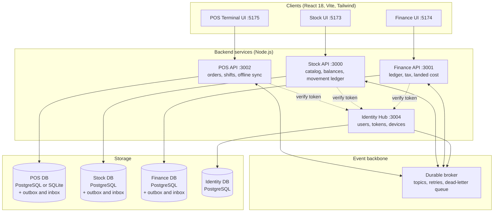
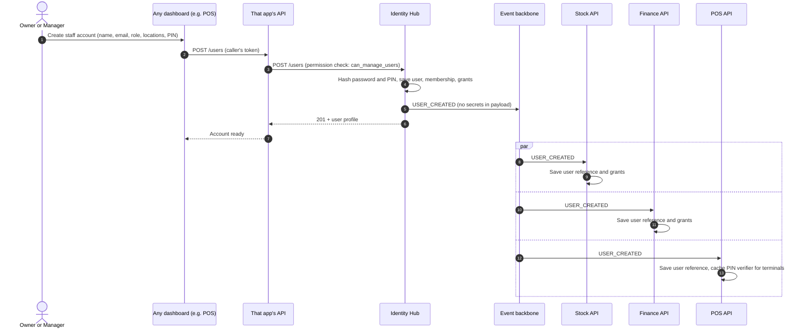
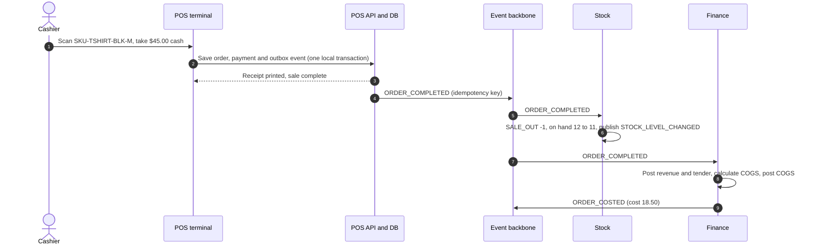

# The Loops Triad: Master Architecture and Implementation Plan (v2)

**Universal POS + Stock Management Loops + Loops Finance (Account System Loops)**

| System | Folder | API | UI |
| --- | --- | --- | --- |
| The Loop.s POS | `The_Loop.s_POS` | 3002 | 5175 |
| Stock Management Loops | `Stock_management_loops` | 3000 | 5173 |
| Loops Finance (V3) | `account_system_Loops` | 3001 | 5174 |
| Identity Hub (new, proposed) | `loops_identity` | 3004 | none (login screens live in each app) |
| Event backbone (new) | broker + outbox/inbox in each service | n/a | monitor page in Finance Settings |

---

## 0. What changed from v1

| # | v1 | v2 | Why |
| --- | --- | --- | --- |
| 1 | Services call each other directly (`POST /api/movements`, `POST /api/journal-entries`) | Each service publishes events; the others consume them (transactional outbox, idempotent inbox, retry, dead-letter queue) | One service being down must never lose or duplicate a sale |
| 2 | User and password synced into all three databases | Identity Hub is the only place credentials exist; other systems keep a user reference and local grants | One password store to secure, revoke and audit |
| 3 | Shared `LOOPS_JWT_SECRET` signs tokens | Asymmetric signing (Identity Hub holds the private key, others verify with a public key); short-lived access token, rotating refresh token, one audience per service | A leak in one app can no longer forge tokens for all |
| 4 | Single company, single store implied | `organization_id`, `location_id`, `register_id` on every record from day one | Retrofitting multi-store later breaks reports and permissions |
| 5 | POS creates journal entries and sends COGS | POS sends a sales event. Finance owns the accounting rules and calculates COGS | POS must not invent accounting; Finance V3 already defines posting rules |
| 6 | Stock has one quantity | On-hand, reserved, available, incoming | Two registers must not sell the same last unit |
| 7 | "Real-time" implied one atomic update everywhere | Near-real-time with guaranteed delivery, eventual consistency, daily reconciliation | Three databases cannot commit one transaction together |
| 8 | Each system equally authoritative | One authoritative owner per data type (Section 2) | Prevents circular sync and conflicting edits |
| 9 | Finance on MySQL, Stock on JSON file ledger | PostgreSQL for Stock and Finance | Exact decimals, row-level tenant isolation, real transactions (Finance V3 already requires this) |
| 10 | `ON DELETE CASCADE` on orders, `INT` quantity, no refund tables | Restrictive deletes, decimal quantities, refund and cash-movement tables, audit log | Sales records are financial records and are never deleted |
| 11 | Cash over/short and cash deposits not defined in the ledger | New Finance account and posting rules (Section 9) | Z-Report needs somewhere to post |
| 12 | Roadmap put hardware before sync | Identity and event backbone first, then POS, then integration, offline, hardware | Everything else depends on the backbone |

---

## 1. Directives

1. **One identity.** Create a user on any dashboard and they get access to the systems their role allows, with no second registration.
2. **Reliable near-real-time sync.** A sale, return, stock movement, price change or shift close reaches the other systems within seconds, and nothing is lost or posted twice, even if a system is down or the store is offline.
3. **One owner per fact.** Every piece of data has exactly one authoritative system. Others hold copies.
4. **Fast checkout.** The cashier never waits on Stock or Finance. The POS completes the sale locally and syncs afterward.
5. **Accounting is automatic and correct.** Every sale posts balanced entries by Finance's rules.

---

## 2. Data ownership

| Data | Authoritative system | Others |
| --- | --- | --- |
| Employees, credentials, sessions, devices | **Identity Hub** | Keep user ID, name, role, location grants |
| Roles and permission definitions | **Identity Hub** | Apply them locally |
| Product catalog, SKU and variant identity, barcodes | **Stock Management** | POS and Finance keep read-only copies |
| Base price and price lists, promotions | **Stock Management** (catalog owner) | POS receives price list versions |
| Tax codes and rates | **Finance** | POS receives tax config versions |
| Inventory quantities and movements | **Stock Management** | POS shows availability; Finance reconciles |
| Purchase orders, goods receiving | **Stock Management** | Finance records commitments and GRNI |
| Checkout, sales orders, tender capture | **POS** | Stock and Finance consume `ORDER_COMPLETED` |
| Registers, shifts, cash drawer counts | **POS** | Finance receives the Z-Report event |
| Customers and store credit balance | **Finance** (balance), shared customer ID | POS reads balance and requests a redemption |
| Supplier invoices, landed cost, inventory cost and COGS | **Finance** | Stock and POS show cost read-only |
| General ledger, payments to suppliers, bank, financial statements | **Finance** | None |

**Rule:** a system never writes data it does not own. It asks the owner by publishing an event or calling the owner's API.

---

## 3. System architecture



**Technology choices**

- **Databases:** PostgreSQL for Identity, Stock and Finance. POS store server uses PostgreSQL, or SQLite for a single-terminal install. Each terminal also keeps a local persistent queue (see Section 7.4).
- **Broker:** start with the simplest durable option you can operate, for example RabbitMQ or NATS JetStream. Both support retries, acknowledgements and dead-letter queues. Services talk to it only through a small shared `events` library, so the broker can change later.
- **Money:** Decimal.js in code, `NUMERIC(19,4)` in PostgreSQL, never floats. Exchange rates `NUMERIC(19,8)`.
- **Validation:** Zod schemas for every event payload, shared as a versioned package.
- **Real-time UI:** Server-Sent Events or WebSocket from each backend to its own UI for live stock and sales views.

---

## 4. Identity and access

### 4.1 Principles

- The **Identity Hub owns** email, password hash (argon2id or bcrypt), PIN hash, user status, sessions, devices and role assignments.
- Stock, POS and Finance store only: `user_id`, display name, role, location grants, active flag. **No passwords or PIN hashes in their databases.**
- A user created from any dashboard is created by calling the Identity Hub. The Hub then publishes `USER_CREATED`; each system updates its local user reference.

### 4.2 Provisioning flow



The user can sign in anywhere the role allows as soon as the Hub confirms creation; the local references only drive display and local permission checks.

Also published: `USER_UPDATED` (role, location or name change), `USER_DEACTIVATED` (immediate lockout), `USER_PIN_RESET`.

### 4.3 Tokens

| Item | Design |
| --- | --- |
| Signing | Asymmetric key pair. Hub signs; services verify with the public key (JWKS endpoint). No shared secret. |
| Access token | 10 to 15 minutes. Claims: `sub`, `org`, `role`, `locations`, `aud` (one service), `jti`. |
| Audience | A token for the POS API is not accepted by Finance. The Hub issues service-specific tokens (token exchange) when a user opens another app. |
| Refresh token | Rotating. Each use issues a new one; reuse of an old one revokes the whole session family. |
| Revocation | Deactivation and logout add the session to a revocation list that services check, and the `USER_DEACTIVATED` event invalidates cached grants. |
| Backoffice login | Email + password, with optional MFA for Owner, Accountant and Admin roles. |
| Service to service | Separate machine credentials per service and audience, never user tokens. |

### 4.4 Cashier PIN

- The PIN is a **fast unlock on a registered POS device**, not a login to the web apps.
- Valid only for the cashier's assigned locations, on devices registered in the Hub.
- Stored as a salted hash. Terminals cache the verifier so offline unlock works, with an expiry (for example 24 hours since last online check).
- Rate limit: lock the PIN after a set number of wrong tries; manager unlock required.
- PIN must be unique within a location to identify the cashier; reject trivial PINs (0000, 1234).
- Every PIN unlock, failure and lockout is audited.

### 4.5 Roles and permissions

Use **permissions** (what you can do) grouped into roles, scoped by **location**. A role alone is not enough; a store manager manages only their stores.

| Role | POS | Stock | Finance |
| --- | --- | --- | --- |
| **SUPER_ADMIN** (Owner) | Everything, including overrides and voids | Everything | Everything, including period close and users |
| **STORE_MANAGER** | Open and close registers, discounts, refunds, approve voids, X and Z reports, cash movements | Manage stock and transfers for own locations, accept POs | View sales, register reconciliations, shift variances |
| **CASHIER** | Ring sales, take payments, PIN switch, small refunds within limit | View availability | No access (sales post automatically) |
| **INVENTORY_CLERK** | Catalog and stock lookup | Receiving (GRN), cycle counts, movement logging | View PO and landed-cost receipts |
| **ACCOUNTANT** | View completed sales and shift reports | View stock valuation and movements | Full ledger, reports, tax, landed cost, period close |

Sensitive actions (void, refund above a limit, price override, cash payout, stock write-off) require a permission **and**, above a configured amount, a second person's approval.

---

## 5. Multi-company and multi-location from day one

Every business record carries:

| Field | Meaning | Finance V3 equivalent |
| --- | --- | --- |
| `organization_id` | The company (tenant). Hard isolation boundary. | `Business` |
| `location_id` | Store or warehouse | Branch dimension |
| `register_id` | A POS register (POS only) | Channel or sub-dimension |
| `sales_channel` | `POS`, `ONLINE`, `WHOLESALE` | Channel dimension |

Rules:

- Every API call and event is scoped to one organization; queries filter by it, and PostgreSQL row-level security enforces it.
- Users hold memberships per organization with location grants.
- Stock is held per location. Transfers are two movements linked by one transfer ID.
- Reports roll up to location, organization and consolidated levels.

---

## 6. Event backbone

### 6.1 Event envelope (all events)

```json
{
  "eventId": "uuid",
  "eventType": "ORDER_COMPLETED",
  "schemaVersion": 1,
  "organizationId": "uuid",
  "locationId": "uuid",
  "registerId": "uuid",
  "sourceSystem": "POS",
  "sourceTransactionId": "order uuid",
  "sequence": 1042,
  "occurredAt": "2026-11-01T08:15:30Z",
  "effectiveDate": "2026-11-01",
  "idempotencyKey": "POS:<register>:<seq>",
  "correlationId": "uuid",
  "payload": { },
  "checksum": "sha256"
}
```

`sequence` is per register (or per source stream) so consumers can detect gaps and process in order.

### 6.2 Delivery guarantees

1. **Transactional outbox.** The producer saves the business record and the event row in the **same database transaction**. A relay publishes pending rows to the broker.
2. **At-least-once delivery.** The broker redelivers until acknowledged.
3. **Idempotent inbox.** Each consumer records `eventId` in its inbox table before acting; a repeated event is acknowledged and ignored.
4. **Retries with backoff**, then **dead-letter queue** after a set number of attempts.
5. **Ordering.** Events for the same aggregate (one order, one SKU at one location) are processed in sequence. A refund waits for its sale.
6. **Replay.** Authorized staff can replay a dead-lettered or past event from the monitor page; idempotency makes this safe.
7. **Schema versions.** Consumers accept the current and previous version for at least one release cycle.
8. **Poison messages** go to the dead-letter queue immediately with the validation error, and raise an alert.

### 6.3 Event catalog

| Event | Producer | Consumers and effect |
| --- | --- | --- |
| `USER_CREATED`, `USER_UPDATED`, `USER_DEACTIVATED`, `USER_PIN_RESET` | Identity Hub | All: update user reference and grants |
| `PRODUCT_CATALOG_UPDATED` | Stock | POS: update catalog and barcodes. Finance: update SKU reference. |
| `PRICE_LIST_PUBLISHED` | Stock | POS: new price list version, effective date |
| `TAX_CONFIG_PUBLISHED` | Finance | POS: new tax codes and rates, effective date |
| `ORDER_COMPLETED` | POS | **Stock:** deduct stock. **Finance:** post revenue, tax, tender clearing, and calculate and post COGS. |
| `ORDER_VOIDED` | POS | Stock: release. Finance: reverse. |
| `REFUND_COMPLETED` | POS | Finance: reverse revenue and tax, post refund. Stock: nothing until the return is assessed. |
| `RETURN_ASSESSED` | POS (or Stock) | Stock: restock if resellable. Finance: restore inventory at original cost, or write off if damaged. |
| `ORDER_COSTED` | Finance | POS and Stock: record cost snapshot for margin display (read-only) |
| `CASH_MOVEMENT_RECORDED` | POS | Finance: paid-in, paid-out, safe drop postings |
| `SHIFT_CLOSED` | POS | Finance: reconcile tenders, post cash over or short, post cash deposit when banked |
| `GOODS_RECEIVED` | Stock | Finance: inventory or goods in transit against GRNI. POS: availability. |
| `STOCK_ADJUSTED`, `STOCK_DAMAGED`, `STOCK_TRANSFERRED` | Stock | Finance: valuation adjustments, write-offs, location reconciliation |
| `RESERVATION_CREATED`, `RESERVATION_RELEASED` | Stock | POS: availability update |
| `SHIPMENT_COST_FINALIZED` | Finance | Stock and POS: final unit cost, read-only |
| `INVENTORY_VALUE_SNAPSHOT` | Finance | Stock: reconciliation |
| `STOCK_LEVEL_CHANGED` | Stock | POS: availability badge on variant tiles |

**Removed from v1:** POS sending `COGS` amounts, POS calling Finance's journal API, and Finance directly calling Stock to "update cost". Cost is published as an event and displayed read-only.

---

## 7. The Loop.s POS

### 7.1 Responsibilities

Checkout, discounts, split tender, shifts and cash drawer, receipts, returns and refunds at the counter, offline operation, hardware, and publishing sales events. Nothing else.

### 7.2 Project layout

```
The_Loop.s_POS/
├── backend/                         # Node.js, port 3002
│   ├── src/
│   │   ├── server.js                # REST API, SSE stream
│   │   ├── auth/                    # token verification (JWKS), PIN unlock, device registration
│   │   ├── orders/                  # orderEngine: cart, discount, tax, rounding, snapshots
│   │   ├── returns/                 # refunds, exchanges, return assessment
│   │   ├── shifts/                  # float, X-Report, Z-Report, cash movements
│   │   ├── catalog/                 # local catalog, price list and tax config versions
│   │   ├── events/                  # outbox relay, inbox consumers, schemas
│   │   ├── receipts/                # ESC/POS 80mm, PDF
│   │   └── db/                      # migrations, repositories
│   └── package.json
└── frontend/                        # React 18 + Vite + Tailwind, port 5175
    ├── src/
    │   ├── components/
    │   │   ├── TerminalHeader.jsx       # cashier, online/offline pill, location, register
    │   │   ├── ProductCatalogGrid.jsx   # search, categories, variant picker
    │   │   ├── BarcodeListener.jsx      # USB HID scanner listener
    │   │   ├── ActiveCart.jsx           # lines, quantity, line discount, notes
    │   │   ├── CheckoutModal.jsx        # split tender, change, store credit
    │   │   ├── RefundModal.jsx          # find receipt, select lines, reason, approval
    │   │   ├── ShiftModal.jsx           # open with float, blind count close
    │   │   ├── CashMovementModal.jsx    # paid in, paid out, safe drop
    │   │   ├── ReceiptPreview.jsx
    │   │   └── SyncStatusPanel.jsx      # queue depth, last sync, failed items
    │   ├── context/
    │   │   ├── PosContext.jsx           # cart, cashier, register
    │   │   └── SyncContext.jsx          # network and sync heartbeat
    │   ├── offline/                     # local DB, queue, sync worker
    │   ├── App.jsx
    │   └── main.jsx
    └── tailwind.config.js
```

Staff management is **not** a POS component any more. The POS links to the shared user-management screen, which calls the Identity Hub. Visual design follows `design_system_skill.md` and `Pro_max_skill_Ui.md`.

### 7.3 Terminal features

1. **Variant picker:** one-tap Color x Size x Finish x Capacity, with live availability on each tile (for example `Matte Black / Large (8 available)`, `Titanium / Small (out of stock)`). Shows **available**, not raw on-hand.
2. **Scanning:** USB keyboard-wedge listener works without focus on a field; camera scan fallback on tablets. Unknown barcode shows a clear message, never a silent failure.
3. **Split tender:** any mix of cash, card, QR (KHQR), store credit, such as `$50.00 cash + $75.00 card + $10.00 store credit`. Quick cash buttons. Live change calculation. Optional dual-currency tender (for example USD and KHR) with the exchange rate stored on the payment.
4. **Discounts and promotions:** line and order discounts with reason codes and role limits above which a manager PIN is required. Price overrides are logged.
5. **Returns and exchanges:** look up the original receipt, select lines, choose reason, refund to original tender or store credit, mark each returned item as resellable, damaged or pending inspection. Refund limits per role.
6. **Hold and recall:** park a cart and resume it (a parked cart does not reserve stock unless configured).
7. **Receipts:** 80mm thermal and PDF, with reprint marked "Copy". Sale number is unique per register.
8. **Shift lifecycle:**
   - **Open:** count and record the opening float.
   - **During:** X-Report (read-only interim totals by tender), paid in, paid out, safe drops, each with reason and approver.
   - **Close:** blind cash count, system shows expected cash only after the count is entered, difference recorded as over or short, manager approval for large differences, then `SHIFT_CLOSED` is published.
9. **Customer lookup** for store credit and loyalty (optional later).

### 7.4 Offline-first design

The terminal never blocks a sale for lack of a connection.

| Topic | Design |
| --- | --- |
| Local store | SQLite on the terminal or store server (preferred), or IndexedDB with persistent storage requested. Browser storage can be cleared, so queued sales are also sent to the store server whenever it is reachable. |
| What is cached | Catalog and barcodes, price list version, tax config version, cashier PIN verifiers (with expiry), customer store-credit balances (read-only snapshot). |
| Order identity | Order ID is a UUID created on the terminal. Order number includes the register code and a per-register counter, so offline terminals never collide, for example `REG01-20261101-0042`. |
| Snapshots | Each sale stores the price list version and tax config version it used, so it posts correctly even if prices changed before sync. |
| Queue | Sales and shift events are written to the local outbox in the same local transaction as the order. A sync worker sends them in register sequence order with idempotency keys. Exponential backoff on failure. |
| Card and QR payments | Card terminals that approve offline are provider-specific; by default, card and QR require a live connection. Cash and store credit (within the cached balance and limit) work offline. |
| Oversell | Offline sales may exceed stock. On sync, Stock records a negative balance, raises an "oversold" alert and does not reject the sale. |
| Clock | Events carry device time and server receive time; large clock drift is flagged. |
| Visibility | Header pill shows Online, Syncing (n waiting) or Offline. The Sync panel lists failed items with a retry button. |
| Closing a shift offline | Allowed. The Z-Report is queued and posts after sync. |

### 7.5 Hardware

USB barcode scanner, 80mm ESC/POS thermal printer, cash drawer kick via printer, customer display (optional), camera scanner, card terminal through the payment provider's SDK or hosted terminal. The POS stores only a reference code and last four digits for card payments, **never card numbers**.

---

## 8. Inventory: on-hand, reserved, available, incoming

Owned by Stock Management.

```
available = on_hand - reserved
```

| Quantity | Meaning |
| --- | --- |
| On hand | Physically in the location |
| Reserved | Committed to a pending order, transfer out or hold |
| Available | What the POS may sell |
| Incoming | On approved purchase orders or in-transit transfers (informational) |

Rules:

1. Stock keeps an **append-only movement ledger**. Balances are derived from it, with a cached balance table for speed. Use PostgreSQL, not a JSON file.
2. A POS sale event creates a `SALE_OUT` movement. If the order is held for fulfilment, `RESERVATION_CREATED` locks the quantity first; reservation and sale conversion are atomic in Stock.
3. Two registers selling the last unit: whichever event Stock processes first succeeds; the other is flagged oversold (the customer already has the product, so the sale stands and a manager is alerted).
4. Reservations expire automatically after a set time unless confirmed.
5. Returns create `CUSTOMER_RETURN` only when the item is assessed resellable; damaged items create a write-off movement.
6. POS shows availability from its cached balance plus pending local sales, refreshed by `STOCK_LEVEL_CHANGED`.
7. Cycle counts and adjustments need approval above a threshold.

---

## 9. Accounting integration (owned by Finance)

POS sends **facts** (what was sold, taxed, discounted and tendered). Finance applies the posting rules, using the Finance V3 chart of accounts, and creates balanced, immutable journals tied to the event ID. POS never sends account codes or COGS.

### 9.1 Posting rules for POS events

| Event | Debit | Credit | Notes |
| --- | --- | --- | --- |
| Cash tender on a sale | 1010 Cash on Hand | 4010 Sales Revenue; 2030 Output VAT; 4015 Shipping Income if any | Discounts shown to 4030 |
| Card or QR tender | 1030 Payment Gateway Clearing | same as above | Cleared when the provider pays out |
| Store credit tender | 2080 Customer Deposits and Store Credit | same as above | Reduces the customer's balance |
| Cash rounding | 6090 Rounding Differences | 4010 or 1010 as applicable | Only when a currency has no smallest coin |
| Cost of sale (calculated by Finance) | 5010 Landed Cost of Goods Sold | 1200 Inventory | Weighted-average cost at the time of sale, published back as `ORDER_COSTED` |
| Payment provider payout | Bank (1020); 6015 Payment Gateway Fees | 1030 Gateway Clearing | Fee is recorded when the settlement arrives |
| Refund to cash | 4020 Sales Returns; 2030 Output VAT | 1010 Cash | |
| Refund to card or QR | 4020; 2030 | 1030 or 2090 Refunds Payable | |
| Refund to store credit | 4020; 2030 | 2080 | |
| Return assessed resellable | 1200 Inventory | 5010 COGS | At the original cost |
| Return assessed damaged | 5020 Damaged Inventory Write-off | 5010 COGS | No stock restored |
| Cash paid in | 1010 | Source account chosen by reason code | For example 3010 Owner Capital |
| Cash paid out | Expense account by reason code | 1010 | Needs reason and approver |
| Safe drop and bank deposit | 1020 Bank | 1010 Cash | Posted when banked |
| Shift close: cash short | 6095 Cash Over and Short | 1010 | **New account** (add to Finance chart) |
| Shift close: cash over | 1010 | 6095 Cash Over and Short | |

**Account to add to the Finance chart of accounts:** `6095 Cash Over and Short` (Operating expense, either side, system account).

### 9.2 Rules

1. **COGS is Finance's job.** It uses the current weighted-average cost per SKU at the effective date. If the landed cost is later finalized, Finance posts the adjustment as in Finance V3; POS records are never edited.
2. **Price and tax snapshots.** Each order line stores the tax code, rate and amount used. Finance posts exactly those amounts.
3. **Tax-inclusive or exclusive prices** is a per-organization setting; line amounts always store tax separately.
4. **Idempotency.** Finance's inbox stores `eventId`; a repeated `ORDER_COMPLETED` creates no second journal.
5. **Failed posting.** If Finance rejects an event (closed period, unknown SKU, missing cost), it goes to the dead-letter queue with the reason, appears in Finance Home as "Needs attention", and the sale is unaffected in POS and Stock.
6. **Closed periods.** An event whose effective date falls in a locked period posts into the first open period with a flag and an alert, according to the organization's policy.
7. **Volume.** At high sales volume, Finance may post **one summarized journal per register per shift** (or per day) instead of one per order, keeping the order-level detail in a linked sub-ledger. Choose before building; the event contract is the same either way.

### 9.3 Z-Report reconciliation

`SHIFT_CLOSED` carries: tender totals by method, counted cash, expected cash, over or short, cash movements, order count and range of order numbers. Finance checks:

- Sum of posted order tenders for that shift equals the report's tender totals.
- Missing or duplicate orders are listed as a mismatch and block "reconciled" status until resolved.

---

## 10. End-to-end scenarios

### Scenario A: Retail sale (online)



Finance posts (example without tax):

| Line | Debit | Credit |
| --- | --- | --- |
| 1010 Cash on Hand | 45.00 | |
| 4010 Sales Revenue | | 45.00 |
| 5010 Landed COGS | 18.50 | |
| 1200 Inventory | | 18.50 |

Same sale with an example 10% tax-inclusive price: revenue 40.91, output tax 4.09, cash 45.00. (The rate is an example; use your configured tax codes.)

### Scenario B: Refund and return

1. Cashier finds the original receipt, selects the shirt, reason "wrong size", approval required if above limit.
2. POS saves the refund and publishes `REFUND_COMPLETED`; Finance reverses revenue and tax and pays out cash.
3. Cashier inspects the item and marks it resellable; POS publishes `RETURN_ASSESSED`.
4. Stock adds 1 unit back; Finance moves 18.50 from COGS back to inventory.

### Scenario C: Create a user from any dashboard

Follow the sequence in Section 4.2. Example: the owner creates `Sokha Meas`, role `STORE_MANAGER`, location Store 1, PIN set. The Hub saves credentials; Stock, Finance and POS receive `USER_CREATED`; Sokha logs in on port 5173 or 5174 with email and password, and unlocks Register 1 with the PIN.

### Scenario D: Offline sales

1. Network drops. Terminal shows Offline. Three cash sales complete and are saved to the local queue with sequence 101, 102, 103.
2. Connection returns. The sync worker sends events in order with idempotency keys.
3. Stock and Finance process each exactly once. If the connection dropped mid-send and the worker resends, the inbox ignores duplicates.
4. Sync panel shows 0 waiting.

### Scenario E: Close shift

1. Cashier enters blind count: $412.00. Expected cash was $410.00.
2. System records $2.00 over, manager approves, shift becomes closing.
3. `SHIFT_CLOSED` published. Finance reconciles tenders, posts Dr 1010 $2.00 / Cr 6095 $2.00, and marks the shift reconciled.
4. When the manager banks the cash, a deposit is recorded: Dr Bank, Cr 1010.

---

## 11. Database design

### 11.1 Common rules

- UUID primary keys (generated on the device where offline creation is needed).
- `organization_id` on every table; PostgreSQL row-level security.
- `NUMERIC(19,4)` for money and quantities, `NUMERIC(19,8)` for rates, currency code on every monetary row.
- **No `ON DELETE CASCADE` on financial data.** Voids and refunds are new rows.
- Status columns use `CHECK` constraints or enum types.
- Every table: `created_at`, and `created_by` or `updated_by` where users act.

### 11.2 POS schema (PostgreSQL)

```sql
-- The Loop.s POS: multi-company, multi-register, split tender, refunds, outbox

CREATE TABLE pos_registers (
    id               UUID PRIMARY KEY,
    organization_id  UUID NOT NULL,
    location_id      UUID NOT NULL,
    register_code    VARCHAR(20) NOT NULL,           -- REG-01
    name             VARCHAR(100) NOT NULL,
    device_id        UUID,                            -- registered terminal (Identity Hub)
    status           TEXT NOT NULL DEFAULT 'CLOSED' CHECK (status IN ('OPEN','CLOSED','DISABLED')),
    current_shift_id UUID,
    created_at       TIMESTAMPTZ NOT NULL DEFAULT now(),
    UNIQUE (organization_id, location_id, register_code)
);

CREATE TABLE pos_shifts (
    id               UUID PRIMARY KEY,
    organization_id  UUID NOT NULL,
    register_id      UUID NOT NULL REFERENCES pos_registers(id),
    cashier_user_id  UUID NOT NULL,
    currency_code    CHAR(3) NOT NULL,
    opened_at        TIMESTAMPTZ NOT NULL,
    closed_at        TIMESTAMPTZ,
    opening_float    NUMERIC(19,4) NOT NULL DEFAULT 0,
    expected_cash    NUMERIC(19,4),
    counted_cash     NUMERIC(19,4),
    cash_over_short  NUMERIC(19,4),                   -- counted minus expected
    approved_by_user_id UUID,
    status           TEXT NOT NULL DEFAULT 'ACTIVE'
                     CHECK (status IN ('ACTIVE','CLOSING','CLOSED','RECONCILED')),
    created_at       TIMESTAMPTZ NOT NULL DEFAULT now()
);

CREATE TABLE pos_orders (
    id               UUID PRIMARY KEY,                -- created on the terminal
    organization_id  UUID NOT NULL,
    location_id      UUID NOT NULL,
    register_id      UUID NOT NULL REFERENCES pos_registers(id),
    shift_id         UUID NOT NULL REFERENCES pos_shifts(id),
    register_seq     BIGINT NOT NULL,                 -- per-register counter
    order_number     VARCHAR(50) NOT NULL,            -- REG01-20261101-0042
    cashier_user_id  UUID NOT NULL,
    customer_id      UUID,
    sales_channel    TEXT NOT NULL DEFAULT 'POS',
    currency_code    CHAR(3) NOT NULL,
    subtotal         NUMERIC(19,4) NOT NULL,
    discount_total   NUMERIC(19,4) NOT NULL DEFAULT 0,
    tax_total        NUMERIC(19,4) NOT NULL DEFAULT 0,
    rounding_amount  NUMERIC(19,4) NOT NULL DEFAULT 0,
    total_amount     NUMERIC(19,4) NOT NULL,
    price_list_version BIGINT NOT NULL,
    tax_config_version BIGINT NOT NULL,
    status           TEXT NOT NULL DEFAULT 'COMPLETED'
                     CHECK (status IN ('COMPLETED','VOIDED','PARTIALLY_REFUNDED','REFUNDED')),
    idempotency_key  TEXT NOT NULL,
    occurred_at      TIMESTAMPTZ NOT NULL,            -- device time
    received_at      TIMESTAMPTZ NOT NULL DEFAULT now(),
    created_at       TIMESTAMPTZ NOT NULL DEFAULT now(),
    UNIQUE (organization_id, register_id, register_seq),
    UNIQUE (organization_id, order_number),
    UNIQUE (organization_id, idempotency_key)
);
-- COGS is not stored here. Finance owns cost; POS receives ORDER_COSTED for display.

CREATE TABLE pos_order_lines (
    id               UUID PRIMARY KEY,
    organization_id  UUID NOT NULL,
    order_id         UUID NOT NULL REFERENCES pos_orders(id) ON DELETE RESTRICT,
    line_no          INT NOT NULL,
    product_id       UUID NOT NULL,
    variant_sku      VARCHAR(64) NOT NULL,
    item_title       VARCHAR(255) NOT NULL,
    quantity         NUMERIC(19,4) NOT NULL CHECK (quantity > 0),
    unit_price       NUMERIC(19,4) NOT NULL,
    line_discount    NUMERIC(19,4) NOT NULL DEFAULT 0,
    discount_reason  VARCHAR(50),
    tax_code         VARCHAR(30),
    tax_rate         NUMERIC(19,8),
    tax_amount       NUMERIC(19,4) NOT NULL DEFAULT 0,
    line_total       NUMERIC(19,4) NOT NULL,
    UNIQUE (order_id, line_no)
);

CREATE TABLE pos_payments (
    id               UUID PRIMARY KEY,
    organization_id  UUID NOT NULL,
    order_id         UUID NOT NULL REFERENCES pos_orders(id) ON DELETE RESTRICT,
    method           TEXT NOT NULL CHECK (method IN ('CASH','CARD','QR_KHQR','STORE_CREDIT')),
    currency_code    CHAR(3) NOT NULL,
    amount           NUMERIC(19,4) NOT NULL,          -- applied to the order, in tender currency
    exchange_rate    NUMERIC(19,8) NOT NULL DEFAULT 1,
    amount_base      NUMERIC(19,4) NOT NULL,          -- in organization base currency
    tendered_amount  NUMERIC(19,4),
    change_given     NUMERIC(19,4) DEFAULT 0,
    provider         VARCHAR(50),
    reference_code   VARCHAR(100),                    -- provider reference only, never card numbers
    card_last4       CHAR(4),
    status           TEXT NOT NULL DEFAULT 'CAPTURED'
                     CHECK (status IN ('CAPTURED','VOIDED','REFUNDED')),
    created_at       TIMESTAMPTZ NOT NULL DEFAULT now()
);

CREATE TABLE pos_refunds (
    id               UUID PRIMARY KEY,
    organization_id  UUID NOT NULL,
    original_order_id UUID NOT NULL REFERENCES pos_orders(id),
    shift_id         UUID NOT NULL REFERENCES pos_shifts(id),
    cashier_user_id  UUID NOT NULL,
    approved_by_user_id UUID,
    reason_code      VARCHAR(50) NOT NULL,
    refund_method    TEXT NOT NULL CHECK (refund_method IN ('CASH','ORIGINAL_TENDER','STORE_CREDIT')),
    total_refund     NUMERIC(19,4) NOT NULL,
    tax_refund       NUMERIC(19,4) NOT NULL DEFAULT 0,
    idempotency_key  TEXT NOT NULL,
    created_at       TIMESTAMPTZ NOT NULL DEFAULT now(),
    UNIQUE (organization_id, idempotency_key)
);

CREATE TABLE pos_refund_lines (
    id               UUID PRIMARY KEY,
    refund_id        UUID NOT NULL REFERENCES pos_refunds(id) ON DELETE RESTRICT,
    order_line_id    UUID NOT NULL REFERENCES pos_order_lines(id),
    quantity         NUMERIC(19,4) NOT NULL CHECK (quantity > 0),
    amount           NUMERIC(19,4) NOT NULL,
    restock_decision TEXT NOT NULL DEFAULT 'PENDING_INSPECTION'
                     CHECK (restock_decision IN ('RESELLABLE','DAMAGED','PENDING_INSPECTION'))
);

CREATE TABLE pos_cash_movements (
    id               UUID PRIMARY KEY,
    organization_id  UUID NOT NULL,
    shift_id         UUID NOT NULL REFERENCES pos_shifts(id),
    type             TEXT NOT NULL CHECK (type IN ('PAID_IN','PAID_OUT','SAFE_DROP')),
    amount           NUMERIC(19,4) NOT NULL CHECK (amount > 0),
    currency_code    CHAR(3) NOT NULL,
    reason_code      VARCHAR(50) NOT NULL,
    note             TEXT,
    created_by       UUID NOT NULL,
    approved_by      UUID,
    created_at       TIMESTAMPTZ NOT NULL DEFAULT now()
);

-- Reliable event delivery
CREATE TABLE pos_outbox (
    id               UUID PRIMARY KEY,                -- = eventId
    organization_id  UUID NOT NULL,
    register_id      UUID,
    sequence         BIGINT,
    event_type       VARCHAR(60) NOT NULL,
    schema_version   INT NOT NULL,
    aggregate_type   VARCHAR(40) NOT NULL,
    aggregate_id     UUID NOT NULL,
    payload          JSONB NOT NULL,
    checksum         CHAR(64) NOT NULL,
    status           TEXT NOT NULL DEFAULT 'PENDING'
                     CHECK (status IN ('PENDING','PUBLISHED','FAILED')),
    attempt_count    INT NOT NULL DEFAULT 0,
    last_error       TEXT,
    available_at     TIMESTAMPTZ NOT NULL DEFAULT now(),
    created_at       TIMESTAMPTZ NOT NULL DEFAULT now(),
    published_at     TIMESTAMPTZ
);
CREATE INDEX pos_outbox_pending ON pos_outbox (status, available_at);

CREATE TABLE pos_inbox (
    event_id         UUID PRIMARY KEY,
    source_system    VARCHAR(30) NOT NULL,
    event_type       VARCHAR(60) NOT NULL,
    processed_at     TIMESTAMPTZ NOT NULL DEFAULT now(),
    result           TEXT NOT NULL DEFAULT 'OK'
);

CREATE TABLE pos_audit_log (
    id               UUID PRIMARY KEY,
    organization_id  UUID NOT NULL,
    actor_user_id    UUID,
    device_id        UUID,
    action           VARCHAR(60) NOT NULL,            -- VOID, REFUND, PRICE_OVERRIDE, PIN_FAIL...
    entity_type      VARCHAR(40),
    entity_id        UUID,
    before_data      JSONB,
    after_data       JSONB,
    ip_address       INET,
    created_at       TIMESTAMPTZ NOT NULL DEFAULT now()
);
```

Stock Management and Finance use the same `*_outbox`, `*_inbox` and `*_audit_log` structure. Finance's ledger tables are defined in the Loops Finance V3 specification.

### 11.3 Identity Hub tables (summary)

| Table | Purpose |
| --- | --- |
| `id_users` | ID, email (unique), password hash, status, MFA settings, created and last login |
| `id_memberships` | User, organization, role |
| `id_location_grants` | Membership and the locations it may access |
| `id_roles`, `id_permissions`, `id_role_permissions` | Permission model |
| `id_pins` | User, location, PIN hash, failed attempts, locked until |
| `id_devices` | Registered POS terminals, status, last seen |
| `id_sessions` | Refresh token hash, token family, device, expiry, revoked flag |
| `id_audit_log` | Sign-ins, failures, role changes, PIN resets, device registrations |

### 11.4 Stock tables (summary)

| Table | Purpose |
| --- | --- |
| `stock_movements` | Append-only ledger: type, SKU, location, quantity, source event, reference |
| `stock_balances` | `on_hand`, `reserved`, `incoming` per SKU and location (rebuildable from movements) |
| `stock_reservations` | Reserved quantity, owner reference, expiry |

---

## 12. Security

- HTTPS everywhere; mutual TLS or signed service credentials between services.
- Passwords: argon2id (or bcrypt with a high cost). PIN: salted hash, rate-limited.
- No card numbers, CVV or magnetic data stored anywhere. Payments go through a provider's hosted terminal or SDK.
- Row-level security for tenant isolation, role and location checks in every API.
- Approval workflow for voids, large refunds, price overrides, payouts and write-offs.
- Registered devices only for PIN unlock; a lost device can be disabled in the Hub.
- Secrets in a secret manager or environment, never in source control. Key rotation for token signing.
- Rate limiting and input validation (Zod) on every endpoint and every consumed event.
- Receipts and Z-Reports contain no more personal data than needed.
- Daily encrypted backups of all four databases with a monthly restore test.

---

## 13. Observability, audit and recovery

| Area | What to build |
| --- | --- |
| Health | `/health` and `/ready` on every service; uptime dashboard |
| Event monitor | Queue depth, consumer lag, oldest pending event, retry counts, dead-letter list with replay and reason, per consumer |
| Tracing | `correlationId` from the POS order through Stock and Finance; searchable by order number |
| Alerts | Dead-letter growth, consumer stopped, outbox older than N minutes, terminal offline longer than N minutes, shift not closed, reconciliation mismatch, failed backup |
| Audit | Immutable log of sensitive actions in each service; viewable by Owner and Accountant |
| Reconciliation | Daily jobs: (1) POS order count and totals vs Stock `SALE_OUT` movements; (2) POS tender totals vs Finance journals; (3) Stock quantity x cost vs Finance Inventory account; (4) Identity users vs each system's user references. Differences list by order or SKU with a "repost" or "investigate" action. |
| Recovery | Rebuild any consumer from replayed events; rebuild stock balances from the movement ledger; documented runbook for a failed service and for a terminal replaced mid-shift |
| Reports | Sync status report per terminal: last sync time, queue size, failed items |

---

## 14. Implementation roadmap

Build the backbone before features that depend on it. First target: **one company, one store, one register**, a sale reaching Stock and Finance reliably.

| Phase | Deliverable | Key work | Done when |
| --- | --- | --- | --- |
| **0** | Contracts and decisions | Confirm Section 16 decisions. Define event schemas, ownership table, token design, permission list, chart-of-accounts additions (6095). Write scenario tests first. | Contracts and test cases approved |
| **1** | Identity Hub | Users, roles, permissions, location grants, PIN, devices, token issue and refresh, JWKS, `USER_*` events, shared user-management UI | Create a user in any app and sign in to the others with correct role limits |
| **2** | Event backbone | Broker, shared `events` library, outbox relay, inbox, retries, dead-letter queue, replay, event monitor page | Duplicate and failed deliveries are handled in automated tests |
| **3** | Stock Management on PostgreSQL | Movement ledger, balances, reservations, catalog and price events, availability events | Movements derive balances; reservation tests pass |
| **4** | POS backend (3002) | Order engine, tax and price versions, split tender, refunds, shifts, cash movements, outbox | Order, refund and shift flows work with the database alone |
| **5** | POS frontend (5175) | Catalog and variant picker, cart, checkout, shift screens, refund screen, sync panel, design system | A cashier completes a sale, refund and shift without help |
| **6** | Triad integration | `ORDER_COMPLETED`, refund, return, shift events consumed by Stock and Finance; Finance posting rules and COGS; `ORDER_COSTED` back to POS | Sale posts stock and balanced journals exactly once |
| **7** | Offline engine | Local DB and queue, sequence numbers, sync worker, backoff, oversell handling, cached PIN verifiers, sync panel | Offline test (Section 15, test 9) passes |
| **8** | Hardware | HID scanner, ESC/POS printer, cash drawer kick, camera scanning, card terminal | Tested on the real devices |
| **9** | Reconciliation and monitoring | Daily reconciliation jobs, alerts, audit views, backup restore test | Reconciliation shows zero unexplained differences for a test month |
| **10** | Scale-out | Multi-store, multi-register, transfers, consolidated reports, dual-currency tender, customer store credit and loyalty | Second store runs with no code change |

---

## 15. Verification and acceptance tests

1. **Cross-system account creation:** create `cashier1@theloops.com` in the POS. Sign in on Stock (5173) and Finance (5174) immediately. Expected: signs in to Stock with CASHIER limits and is refused by Finance (no Finance access).
2. **Token safety:** a token for the POS API is rejected by Finance. A deactivated user's session stops working within the token lifetime or sooner, and the PIN stops working at the terminals.
3. **Real-time stock:** SKU `SHOE-RUN-42` has 10 units. Sell 2 at the POS. Stock shows a `SALE_OUT` of -2 and a balance of 8 within seconds.
4. **Ledger:** a $100 sale creates a balanced journal: Dr 1010 Cash 100 / Cr 4010 Sales 100, plus COGS Dr 5010 / Cr 1200 calculated by Finance. Trial balance still balances.
5. **Split tender:** $50 cash + $75 card + $10 store credit posts to 1010, 1030 and 2080 respectively, and the customer's credit balance falls by $10.
6. **Refund and return:** refund reverses revenue and tax; restock happens only after the item is marked resellable; a damaged item posts to 5020 and does not restock.
7. **Duplicate delivery:** send the same `ORDER_COMPLETED` three times. Stock has one movement and Finance one journal.
8. **Consumer outage:** stop Finance, sell 5 items, restart Finance. All 5 post once, in order. Stock was unaffected throughout.
9. **Offline:** disconnect a terminal, ring up 3 cash sales, close the shift offline, reconnect. All 3 sales and the Z-Report post without duplicates, in register sequence order.
10. **Last unit race:** two registers sell the last unit. One is processed first; the other is flagged oversold with a manager alert; no crash, no lost sale.
11. **Price and tax versions:** change a price after a sale is queued offline; the queued sale posts at the version it used.
12. **Shift reconciliation:** counted cash $2 over expected. Finance posts the $2 to 6095, tender totals match, shift becomes reconciled. A missing order makes the shift show a mismatch and block reconciliation.
13. **Tenant isolation:** a user in organization A cannot read or write organization B data through any API or direct query.
14. **Dead-letter and replay:** a poison event goes to the dead-letter queue with the reason and an alert; after the fix, replay posts it once.
15. **Backup restore:** restore all four databases into a clean environment and run the daily reconciliation with zero unexplained differences.
16. **Permissions:** cashier cannot exceed refund limit without manager approval; every override appears in the audit log.

**Release gates:** do not go live until tests 4, 7, 8, 9, 12, 13 and 15 pass.

---

## 16. Decisions to confirm

| # | Decision | My recommendation |
| --- | --- | --- |
| 1 | Event broker | RabbitMQ or NATS JetStream; pick the one your team can run reliably |
| 2 | POS database on the store server | PostgreSQL; SQLite only for single-terminal stores |
| 3 | Who owns retail price and promotions | Stock Management (catalog owner), published as versioned price lists |
| 4 | Tax-inclusive or tax-exclusive prices | Per organization setting; show tax separately on receipts |
| 5 | Journal granularity | One journal per order at low volume; summarize per shift or day at high volume |
| 6 | Offline card payments | Not supported by default; cash and store credit only offline |
| 7 | Oversell policy | Allow the sale, alert the manager (the customer already holds the item) |
| 8 | Currencies at the counter | USD base; add KHR tender with stored rate if needed |
| 9 | Refund limits and approval thresholds by role | Set per organization at setup |
| 10 | Stock cost visibility to cashiers | Hidden; only managers and accountants see cost and margin |
| 11 | Hosting model | Cloud for Identity, Stock, Finance; store server or terminal for POS offline capability |
| 12 | Record retention period | Set by local law; confirm before launch |

---

## 17. Summary

The Triad becomes four clear parts: an **Identity Hub** that owns people, **Stock** that owns products and quantities, a **POS** that owns checkout and shifts, and **Finance** that owns the books. They communicate only through **durable, idempotent events**, so each can fail, restart or work offline without losing or duplicating a single sale. Build the identity and event backbone first, then one store end to end, then offline and hardware, then scale to more stores.
