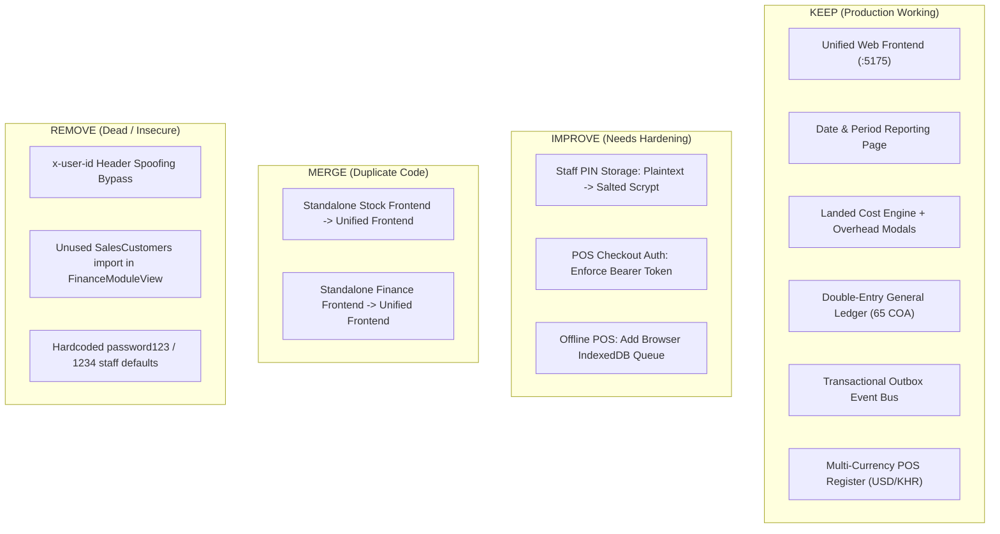

# THE LOOPS UNIVERSAL RETAIL SUITE — DUPLICATE & UNNECESSARY FEATURES REPORT

**Auditor / Roles:** Senior Business Systems Analyst, Full-Stack Architect, UI/UX Specialist  
**Date:** November 3, 2026  
**Scope:** Frontend packages, API endpoints, database structures, business workflows, and navigation across the entire Loops platform.

---

## 1. Classification Guidelines

Every inspected feature, menu, route, and file is assigned one of four definitive business actions:
- **`KEEP`**: Essential, functioning correctly, maintains business value and data integrity.
- **`IMPROVE`**: High-value feature that requires architectural hardening, bug resolution, or UI refinement.
- **`MERGE`**: Redundant duplicate implementation that should be consolidated into a single authoritative component.
- **`REMOVE`**: Dead code, unmounted legacy view, obsolete endpoint, or insecure artifact that serves no business purpose.

> [!IMPORTANT]
> **Data Preservation Rule:** Historical transactions, invoices, journals, stock movements, and audit records are never deleted when a frontend view is updated or retired.

---

## 2. Frontend Inventory & Duplication Analysis

### 2.1 The Three Frontends Dilemma

| Frontend Package | Directory | Active in `start-all.js`? | Recommendation | Action Details |
|---|---|:---:|:---:|---|
| **The Unified Web Frontend** | `The_Loop.s_POS/frontend` (Port 5175) | **YES** | **`KEEP`** | Authoritative production SPA. Embeds POS terminal, Stock view (`src/modules/stock`), Finance view (`src/modules/finance`), and Admin Hub. |
| **Standalone Stock Frontend** | `Stock_management_loops/frontend` | **NO** | **`MERGE` / ARCHIVE** | 100% duplicate of `The_Loop.s_POS/frontend/src/modules/stock`. Not spawned by root supervisor. Consolidate into unified codebase to avoid divergence. |
| **Standalone Finance Frontend** | `account_system_Loops/frontend` | **NO** | **`MERGE` / ARCHIVE** | Duplicate of `The_Loop.s_POS/frontend/src/modules/finance`. It lacks the latest in-app app switcher and proxy updates. Retain backend, archive standalone web folder. |

### 2.2 Component & Navigation Duplications

| Element / Component | Current Location | Status & Finding | Recommendation | Replacement / Corrective Action |
|---|---|---|:---:|---|
| **`SalesCustomers.jsx`** | `The_Loop.s_POS/frontend/src/modules/finance/components/SalesCustomers.jsx` | Replaced by `DatePeriodReporting.jsx` per user specification. Still imported on line 6 of `FinanceModuleView.jsx` as dead code. | **`REMOVE` (Import)** | Retain file for reference/history; delete unused import in `FinanceModuleView.jsx`. |
| **Navbar App Switcher** | `Navbar.jsx` in both Finance frontends | The standalone version in `account_system_Loops` uses `window.open('http://localhost:5175')` while the unified version uses `window.__loops_setAppView`. | **`MERGE`** | Standardize all views on the unified `setAppView()` router in `The_Loop.s_POS/frontend`. |
| **Shipping Categories View** | `ShippingCategoriesView.jsx` | Previously lacked freight adjustment buttons. Recently updated with Edit/Delete modals and dynamic per-unit cost recalculation. | **`KEEP`** | Fully functional and wired to Landed Cost Engine. |
| **Date & Period Reporting** | `DatePeriodReporting.jsx` | Implemented with Daily, Weekly, Monthly, Yearly, Custom presets, store filter, comparison, and PDF/Excel export. | **`KEEP`** | Authoritative financial period reporting studio. |

---

## 3. Backend & API Endpoints Audit

| Endpoint & Method | Microservice | Current Behavior | Recommendation | Corrective Action |
|---|---|---|:---:|---|
| `POST /api/orders/checkout` | POS (:3002) | Accepts cashier checkout. Did not verify incoming Bearer token; checked only payload `cashierUserId`. | **`IMPROVE`** | Enforce caller session authentication and `makeSales` permission check. |
| `POST /api/shifts/open` | POS (:3002) | Verified user via `getRequestUser(req)`. Trusted unverified `x-user-id` header if present. | **`IMPROVE`** | Remove unauthenticated `x-user-id` bypass. Require valid Bearer token. |
| `POST /api/ledger/:id/reverse` | Finance (:3001) | Reverse erroneous journal. In `db.js`, line 1319 excluded reversed entry, causing negative `-50` balance. | **`IMPROVE` (Resolved)** | Fixed in `db.js` line 1318 to keep both entries so debits and credits cancel to `$0.00`. |
| `POST /api/integration/stock/sync-sales` | Finance (:3001) | Synchronizes POS checkout sales into Finance General Ledger. | **`KEEP`** | Essential automated double-entry sales and COGS sync. |
| `POST /api/inventory/import-purchase` | Stock (:3000) | Receives inventory from finalized Finance landed cost shipment and pushes unit costs. | **`KEEP`** | Core inter-service landed cost bridge. |
| `POST /api/catalog/sync-product` | POS (:3002) | Updates POS catalog when products are received in Stock. | **`KEEP`** | Ensures catalog accuracy across registers. |

---

## 4. Database & Persistence Layer Findings

| Persistence Target | Type | Usage | Recommendation | Action |
|---|---|---|:---:|---|
| `data/theloops_enterprise.db` | SQLite WAL (Node 24) | Auth sessions (`sessions`, `sessions_v2`), organizations, stores, outbox (`integration_events`). | **`KEEP`** | Primary relational operational core. WAL mode active. |
| `Stock: store.json` | JSON ACID | Multi-variant products, warehouses, stock balances, movements. | **`KEEP`** | Resilient offline-first local state. |
| `Finance: loops_finance_state.json` | JSON ACID | General Ledger journals, Chart of Accounts, supplier bills, shipments. | **`KEEP`** | Resilient double-entry state engine. |
| `POS: pos_state.json` | JSON ACID | Registers, shifts, sales orders, saved carts, cash movements. | **`KEEP`** | Resilient POS register engine. |
| `schema_mysql.sql` | SQL DDL | Target production schema for future managed MySQL migration. | **`KEEP`** | Retained for planned cloud migration phase. |

---

## 5. Summary Table: What to Keep, Improve, Merge, and Remove

